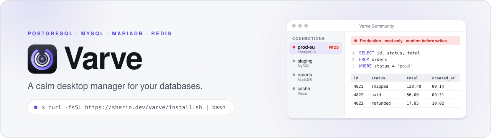
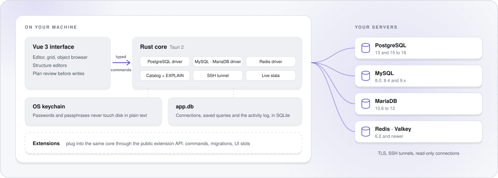

<div align="center">

<picture>
  <source media="(prefers-color-scheme: dark)" srcset="assets/readme/banner-dark.svg">
  
</picture>

<br>

<a href="https://github.com/getvarve/varve/actions/workflows/ci.yml"></a>
<a href="https://github.com/getvarve/varve/releases/latest"></a>
<a href="LICENSE"></a>


**Varve** is a calm desktop manager for PostgreSQL, MySQL, MariaDB and Redis: one app, every engine, careful around production.<br>
Repo: [github.com/getvarve/varve](https://github.com/getvarve/varve)

[Install](#-install) · [How it works](#-how-it-works) · [Features](#-features) · [Editions](#-editions) · [Develop](#-develop) · [Contributing](#-contributing)

</div>

<br>

## ✨ Highlights

- **Every engine, fully.** PostgreSQL, MySQL, MariaDB and Redis, each with its own objects: materialized views, partitions, events, system-versioned tables, streams.
- **Safe around production.** Environment tags, read-only connections, a plan to review before every structure change, and a confirmation before destructive statements.
- **Quiet by design.** A dense, calm interface where color only means something: production is red, and nothing else is.
- **Secrets stay local.** Passwords and SSH passphrases live in your OS keychain, and your queries and data only travel to your own servers.
- **Fast where it counts.** A Rust core with native drivers, cancellable queries and a grid that stays smooth on large result sets.
- **Open core.** Varve Community is complete on its own and Apache-2.0. Pro adds closed extensions through the same public API.

## 📦 Install

### macOS / Linux

```bash
curl -fsSL https://sherin.dev/varve/install.sh | bash
```

Pin a release with `bash -s`:

```bash
curl -fsSL https://sherin.dev/varve/install.sh | bash -s v0.1.2
```

- **macOS** (Apple silicon and Intel): installs `Varve Community.app` in `/Applications`, or in `~/Applications` when `/Applications` is not writable.
- **Linux** (x64 and arm64, glibc 2.35 or newer: Ubuntu 22.04, Debian 12, Fedora 36 and later): installs the AppImage in `~/.local/share/varve`, adds Varve to your app menu, and links a `varve` command into `~/.local/bin` when that folder is on your `PATH`. AppImages need FUSE 2 (`libfuse2t64` or `libfuse2` on Debian and Ubuntu); the installer tells you when it is missing.

The script checks every download against `SHA256SUMS` before it installs anything. Run it again to upgrade in place. `VARVE_VERSION` pins a tag the same way as the first argument, and `VARVE_INSTALL` picks another install folder.

### Windows

```powershell
powershell -c "irm https://sherin.dev/varve/install.ps1|iex"
```

Downloads the installer, checks it against `SHA256SUMS` and installs Varve for the current user, without admin rights. `$env:VARVE_VERSION` pins a tag (`v0.1.2`). Windows on ARM runs the x64 build. The silent install also puts a shortcut on your desktop.

<details>
<summary><b>Download an installer yourself</b></summary>

<br>

Every [release](https://github.com/getvarve/varve/releases/latest) has these files, all listed in `SHA256SUMS`:

| Platform | Installer | Also |
| --- | --- | --- |
| macOS Apple silicon | `varve-macos-arm64.dmg` | `varve-macos-arm64.app.tar.gz` |
| macOS Intel | `varve-macos-x64.dmg` | `varve-macos-x64.app.tar.gz` |
| Windows x64 | `varve-windows-x64-setup.exe` | `varve-windows-x64.msi` |
| Linux x64 | `varve-linux-x64.AppImage` | `varve-linux-x64.deb` |
| Linux arm64 | `varve-linux-arm64.AppImage` | `varve-linux-arm64.deb` |

**First launch on macOS.** The builds are not notarized by Apple yet. The install script is not affected, but a `.dmg` you download in a browser is: macOS refuses to open it the first time. Open **System Settings > Privacy & Security** and click **Open Anyway** once. Until the builds carry a Developer ID, macOS also asks once per update before Varve may read the passwords it saved in your keychain.

</details>

<details>
<summary><b>Uninstall</b></summary>

<br>

- **macOS:** move `Varve Community.app` to the Trash.
- **Linux:** remove `~/.local/share/varve`, `~/.local/share/applications/varve.desktop`, `~/.local/share/icons/hicolor/128x128/apps/varve.png` and the `~/.local/bin/varve` link.
- **Windows:** **Settings > Apps > Installed apps > Varve Community > Uninstall**.

Your connections live in `app.db` in the Varve data folder (`~/Library/Application Support/Varve` on macOS, `~/.local/share/Varve` on Linux, `%APPDATA%\Varve` on Windows) and your passwords in the OS keychain under the service `varve`. Remove those too for a clean slate.

</details>

## 🧭 How it works

<picture>
  <source media="(prefers-color-scheme: dark)" srcset="assets/readme/how-it-works-dark.svg">
  
</picture>

The interface never talks to a database itself. It sends typed commands to the Rust core, which owns every connection, keeps secrets in the OS keychain, and records what it ran in a local activity log with secrets redacted. Structure changes come back as a plan and grid edits as a list of pending changes, so you see exactly what will run before it runs; destructive statements ask first.

## 🗂 Features

| | | |
| --- | --- | --- |
| **Connections** | Folders, environment tags, read-only mode, TLS, SSH tunnels with keys or agent | ✅ 0.1 |
| **Query** | Dialect-aware editor, multiple result sets, cancel, history, saved queries, visual EXPLAIN | ✅ 0.1 |
| **Data** | Fast grid with inline editing, filters and a record view | ✅ 0.1 |
| **Structure** | Editors for tables, indexes, constraints, partitions, views, functions, sequences, triggers, events, types and extensions | ✅ 0.1 |
| **Redis** | Key browser, value editors for every type, streams, console, pub/sub, slow log | ✅ 0.1 |
| **Insight** | Live server status and a local activity log | ✅ 0.1 |
| **Users** | Roles and privilege matrices, MySQL accounts, Redis ACLs | 🛠 next |
| **Files** | Dump a database as SQL, run SQL files, import and export CSV, JSON, Excel, Parquet | 🛠 planned |

Tested against PostgreSQL 13 and 15 to 18, MySQL 8.0, 8.4 and 9.x, MariaDB 10.6 to 12, Redis 6.2 and newer, and Valkey.

## 💎 Editions

| | Community | Pro |
| --- | :---: | :---: |
| Everything above | ✓ | ✓ |
| Statistics history and trends | | ✓ |
| Structure Sync, Data Sync, Data Transfer | | ✓ |
| Cloud sync and team workspaces | | ✓ |
| Wrapped, your year in databases | | ✓ |
| License | Apache-2.0 | Commercial |

Varve Community is this repository: free, open source and complete on its own. Pro adds closed extensions through a public extension API. See [docs/open-core.md](docs/open-core.md).

## 🛠 Develop

Requirements: Rust 1.89 or newer, Node.js 22 or newer, and the [Tauri prerequisites](https://tauri.app/start/prerequisites/) for your OS. pnpm is pinned in `package.json`; run it through Corepack or `npx pnpm@12.14.0`.

```bash
pnpm install
pnpm dev            # run the app with hot reload
pnpm tauri build    # build an installer
```

| Check | Command |
| --- | --- |
| Rust format, lint, tests | `cargo fmt --all --check`, `cargo clippy --workspace --all-targets -- -D warnings`, `cargo test --workspace` |
| Frontend types, lint, tests | `pnpm typecheck`, `pnpm lint`, `pnpm test` |
| Open core boundary | `pnpm check:no-pro` |
| Databases for driver work | `docker compose -f dev/docker-compose.yml --profile latest up -d` (see the file for every version) |

`app.db` lives in `<OS data dir>/Varve`; set `VARVE_DATA_DIR` to use another folder and `VARVE_LOG=debug` for more logging. On macOS, [docs/macos-dev-signing.md](docs/macos-dev-signing.md) stops the keychain from asking again after every rebuild.

<details>
<summary><b>Layout</b></summary>

<br>

| Path | What |
| --- | --- |
| `crates/core` | Engines, capabilities and shared errors |
| `crates/driver` | The contract every driver implements: connect, execute, cancel |
| `crates/driver-postgres`, `driver-mysql`, `driver-redis` | The drivers; MySQL covers MariaDB |
| `crates/catalog` | Catalog models, DDL generation, structure editors, EXPLAIN plans, grid editing |
| `crates/live-stats` | Current server status: process lists, variables, cluster and Redis panels |
| `crates/activity` | The local activity log and its secret redactor |
| `crates/tunnel` | SSH tunnels |
| `crates/records` | Folders, connection profiles and saved queries |
| `crates/secrets` | OS keychain access |
| `crates/store` | `app.db` with migrations per namespace |
| `crates/extension` | The extension API: commands, migrations, capabilities, job kinds, activity actions, hooks |
| `crates/jobs`, `redis-syntax` | Job runner (with the Files milestone), Redis console syntax |
| `app/src-tauri` | Tauri shell shared by every edition, plus the Community binary |
| `app/` | Community frontend entry |
| `packages/ui` | The app UI: shell, views, extension slots, design tokens |
| `vendor/` | Patched `tokio-postgres` and `mysql_async` |
| `dev/` | Database version matrix for local development |

</details>

### Releases

Push a signed `vMAJOR.MINOR.PATCH` tag whose version matches `Cargo.toml` and both `package.json` files. CI runs every check on the tagged commit, and only when all of them pass does it build the installers for macOS, Windows and Linux and publish them with `SHA256SUMS` as a GitHub release. Generated art, each from a script you run after editing it:

| What | Script | Then |
| --- | --- | --- |
| App icon (`assets/logo/varve-app-icon*.svg`) | `scripts/app-icon.py` | The commands below, then `scripts/readme-images.py` (the banner draws the same tile) |
| Liquid Glass icon for macOS 26 (`assets/logo/Varve.icon`, compiled to `app/src-tauri/macos/Assets.car`) | `scripts/liquid-glass-icon.sh` (needs Xcode 26 or newer) | Nothing: `app/src-tauri/Info.plist` points macOS at it; older macOS keeps `icon.icns` |
| macOS installer window (`app/src-tauri/dmg/background.png`) | `scripts/dmg-background.py` | Rerun after changing `bundle.macOS.dmg` in `tauri.conf.json`; it reads the window size and icon positions from there |
| README banner and diagram (`assets/readme`) | `scripts/readme-images.py` | Nothing |

The app icon files come from two renders: the macOS one (on Apple's icon grid, with a shadow) for `icon.icns`, the full-bleed one for everything else. `pnpm tauri icon` also writes Android and iOS files, so it writes to a temporary folder and only the files `app/src-tauri/icons` already has are copied back:

```bash
rsvg-convert -w 1024 assets/logo/varve-app-icon.svg -o /tmp/varve-icon.png
rsvg-convert -w 1024 assets/logo/varve-app-icon-macos.svg -o /tmp/varve-icon-macos.png
pnpm tauri icon /tmp/varve-icon.png -o /tmp/varve-icons
pnpm tauri icon /tmp/varve-icon-macos.png -o /tmp/varve-icons-macos
for f in app/src-tauri/icons/*; do cp "/tmp/varve-icons/$(basename "$f")" "$f"; done
cp /tmp/varve-icons-macos/icon.icns app/src-tauri/icons/icon.icns
```

## 🤝 Contributing

Read [CONTRIBUTING.md](CONTRIBUTING.md) first; every commit needs a `Signed-off-by` line.

Built with [Tauri 2](https://tauri.app) · Rust · [Vue 3](https://vuejs.org) · TypeScript · SQLite

## 📄 License

[Apache-2.0](LICENSE). The Varve name and logo are trademarks and are not covered by the license; see [TRADEMARKS.md](TRADEMARKS.md).
