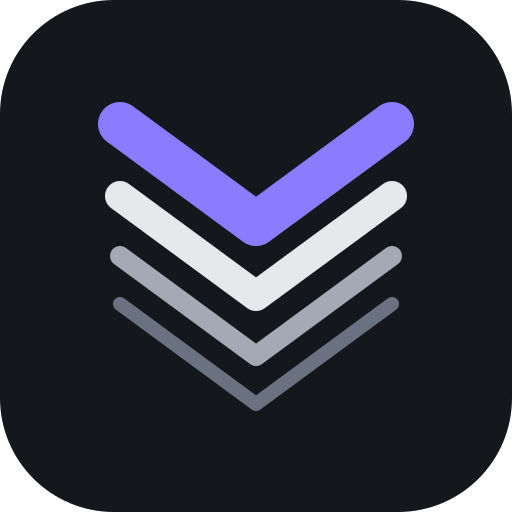

<p align="center">
  
</p>

<h1 align="center">Varve</h1>

<p align="center">
  A calm desktop manager for PostgreSQL, MySQL, MariaDB and Redis.
</p>

<p align="center">
  <a href="LICENSE"></a>
  
  
</p>

---

## Why Varve

- **Every engine, fully.** PostgreSQL, MySQL, MariaDB and Redis, each with its own objects: materialized views, partitions, events, system-versioned tables, streams.
- **Safe around production.** Environment tags, read-only connections and confirmation before destructive statements. Passwords stay in your OS keychain.
- **Quiet by design.** A dense, calm interface where color only means something: production is red, and nothing else is.

## Features

| | |
|---|---|
| **Query** | Dialect-aware editor, multiple result sets, cancel, history, visual EXPLAIN |
| **Data** | Fast grid with inline editing, filters and a record view |
| **Structure** | Editors for tables, indexes, constraints, partitions, views, functions, sequences, triggers, events, types and extensions |
| **Redis** | Key browser, value editors for every type, streams, console, pub/sub, slow log |
| **Users** | Roles and privilege matrices, row-level security, MySQL accounts, Redis ACLs |
| **Files** | Dump a database as SQL, run SQL files, import and export CSV, JSON, Excel, Parquet |
| **Insight** | Live server status and a local activity log |

## Editions

| | Community | Pro |
|---|---|---|
| Everything above | ✓ | ✓ |
| Statistics history and trends | | ✓ |
| Structure Sync, Data Sync, Data Transfer | | ✓ |
| Cloud sync and team workspaces | | ✓ |
| Wrapped, your year in databases | | ✓ |
| License | Apache-2.0 | Commercial |

Varve Community is this repository: free, open source and complete on its own. Pro adds closed extensions through a public extension API. See [docs/open-core.md](docs/open-core.md).

## Status

Early development. **M0 (foundations)** is in place: the Cargo and pnpm workspaces, the Tauri shell, the extension API, local storage and CI. Nothing connects to a database yet. Next up:

1. **M1** Connections and query editor
2. **M2** Object browser and editors

## Develop

Requirements: Rust (stable), Node.js 22 or newer, and the [Tauri prerequisites](https://tauri.app/start/prerequisites/) for your OS. pnpm is pinned in `package.json`; run it through Corepack or `npx pnpm@12.14.0`.

```bash
pnpm install
pnpm dev            # run the app with hot reload
pnpm tauri build    # build an installer
```

| Check | Command |
|---|---|
| Rust format, lint, tests | `cargo fmt --all --check`, `cargo clippy --workspace --all-targets -- -D warnings`, `cargo test --workspace` |
| Frontend types, lint, tests | `pnpm typecheck`, `pnpm lint`, `pnpm test` |
| Open core boundary | `pnpm check:no-pro` |
| Databases for driver work | `docker compose -f dev/docker-compose.yml --profile latest up -d` (see the file for every version) |

`app.db` lives in `<OS data dir>/Varve`; set `VARVE_DATA_DIR` to use another folder and `VARVE_LOG=debug` for more logging.

### Layout

| Path | What |
|---|---|
| `crates/core` | Engines, editions, ids and shared errors |
| `crates/extension` | The extension API: commands, migrations, capabilities, job kinds, activity actions, hooks |
| `crates/store` | `app.db` with migrations per namespace |
| `crates/secrets` | OS keychain access |
| `crates/driver-*`, `catalog`, `jobs`, `live-stats`, `activity`, `tunnel` | Arrive with milestones M1 to M5 |
| `app/src-tauri` | Tauri shell shared by every edition, plus the Community binary |
| `app/` | Community frontend entry |
| `packages/ui` | The app UI: shell, views, extension slots, design tokens |
| `dev/` | Database version matrix for local development |

## Built with

[Tauri 2](https://tauri.app) · Rust · [Vue 3](https://vuejs.org) · TypeScript · SQLite

## Contributing

Read [CONTRIBUTING.md](CONTRIBUTING.md) first; every commit needs a `Signed-off-by` line.

## License

[Apache-2.0](LICENSE). The Varve name and logo are trademarks and are not covered by the license; see [TRADEMARKS.md](TRADEMARKS.md).
